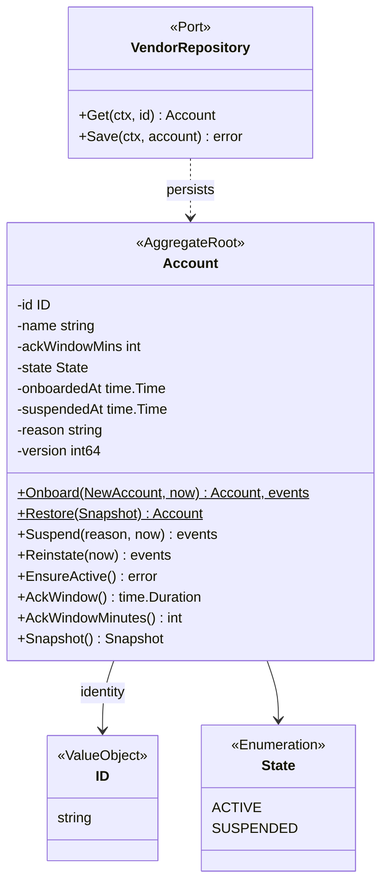
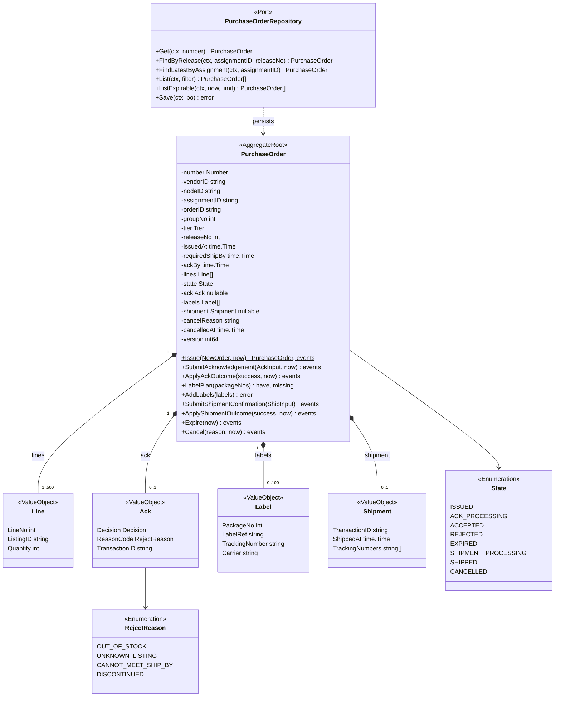
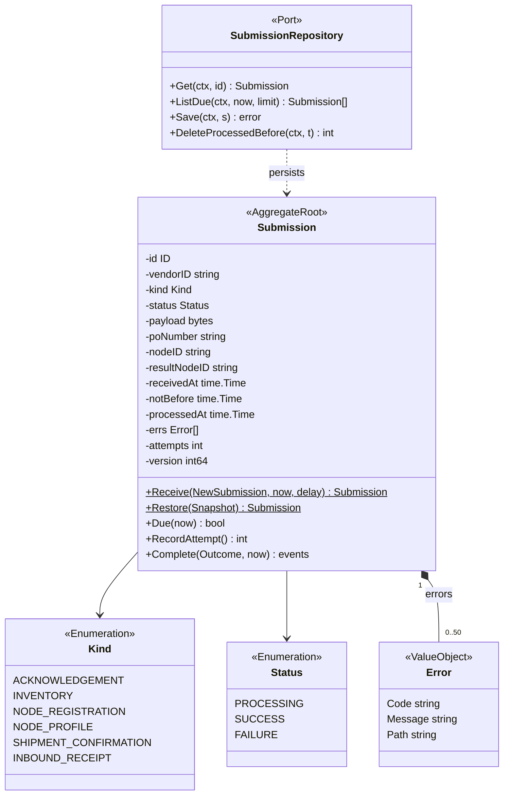
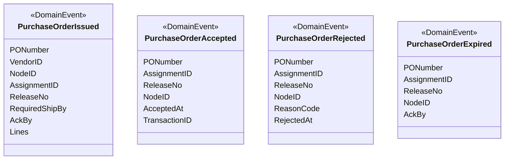
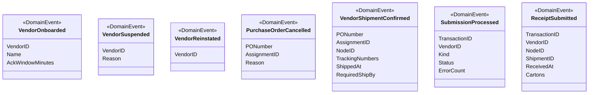
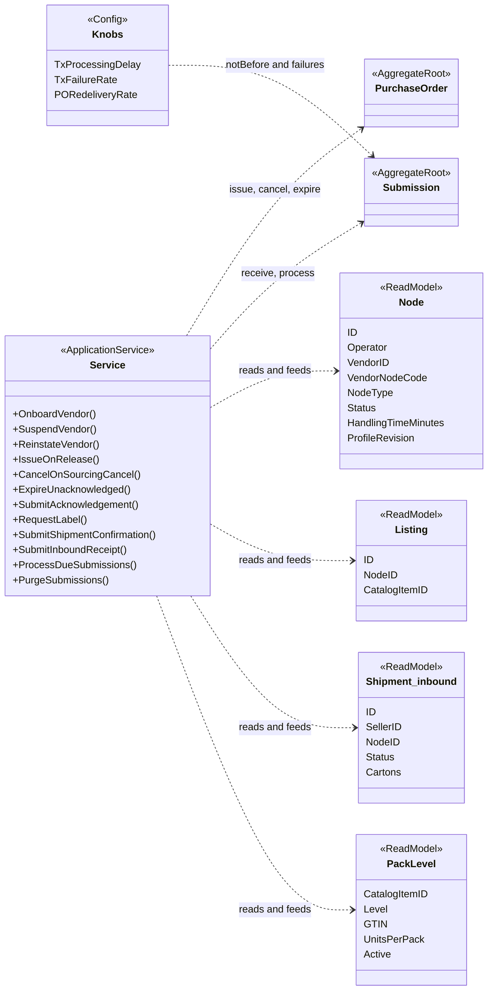
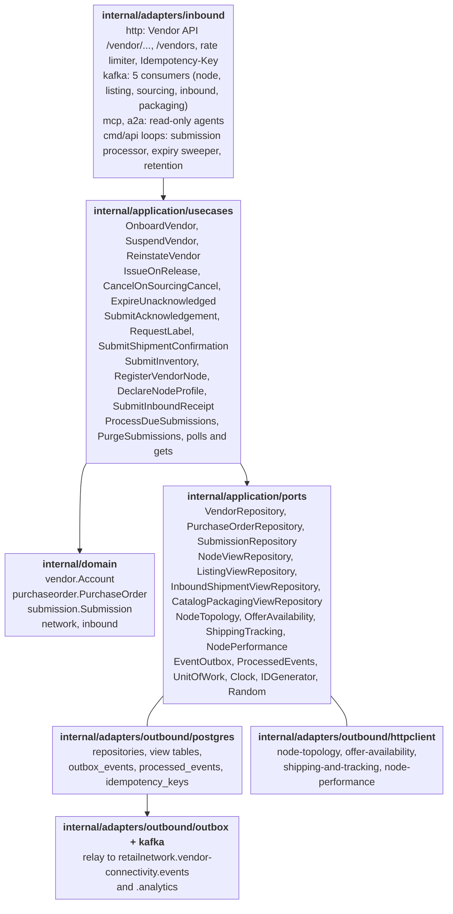

# Class Diagram

UML class diagrams of the Go packages `internal/domain/vendor`, `internal/domain/purchaseorder` and
`internal/domain/submission`, with the ports of `internal/application/ports`. Fields are shown `-`
(unexported), methods `+`; names are the Go identifiers. Aggregates are rebuilt with `Restore(Snapshot)`,
which validates every invariant, and changed through methods that return the domain events they raise.

## 1. VendorAccount

Source: `internal/domain/vendor/vendor.go` and `internal/application/ports/ports.go` (`VendorRepository`).

Omitted: `ErrAckWindowOutOfRange` (from `Onboard`) and `ErrVendorSuspended` (from `EnsureActive`);
`ErrNodeNotOwnedByVendor`, which the use cases check against the node view. The rate limit is not on the
account: it is one process-wide bucket in the HTTP adapter.

## 2. PurchaseOrder

Source: `internal/domain/purchaseorder/purchaseorder.go`, `commands.go`, `commands_ack.go`, `commands_labels.go`, `commands_shipment.go` and `internal/application/ports/ports.go` (`PurchaseOrderRepository`).

Omitted: the errors (`ErrPartialAcknowledgement`, `ErrAlreadyAcknowledged`, `ErrAckWindowClosed`,
`ErrLabelBeforeAcceptance`, `ErrConfirmWithoutLabel`, `ErrCancelAfterAcknowledgement`); the `Tier`
enumeration (`SAME_DAY`, `NEXT_DAY`, `TWO_DAY`, `STANDARD`), the `Decision` enumeration (`ACCEPT`,
`REJECT`), `Number` and the read accessors. `ApplyAckOutcome` and `ApplyShipmentOutcome` are the
`ProcessSubmission` transitions split by kind; `LabelPlan` splits the requested packages into the labels
already held and those still to issue, and `AddLabels` stores what shipping-and-tracking returned.
`Number` is derived by `NumberFor(assignmentID, releaseNo)`.

## 3. Submission

Source: `internal/domain/submission/submission.go` and `internal/application/ports/ports.go` (`SubmissionRepository`).

Omitted: the errors `ErrSubmissionAlreadyProcessed` (from `Complete`) and `ErrSubmissionNotDue`
(`Due` is false before `notBefore`). `poNumber` and `nodeID` are by-value links, not references. The
payload is the vendor's request body verbatim (at most 4 MiB).

## 4. Domain events

Purchase-order acknowledgement events:

Source: `internal/domain/purchaseorder/events.go`.

Account, cancellation, shipment, submission and inbound receipt events:

Source: `internal/domain/vendor/events.go`, `internal/domain/purchaseorder/events.go`, `internal/domain/submission/events.go` and `internal/domain/inbound/receipt.go` (`ReceiptSubmitted` is published as `InboundReceiptSubmitted`).

Omitted: the `shared.Header` every event embeds (aggregate version and occurrence time) and the
CloudEvents envelope; the payload field names are on [Domain events](/docs/ddd/domain-events).

## 5. Use cases and read models

Source: `internal/application/usecases/service.go` (`Service`, `Knobs`, `Deps`), `internal/domain/network/network.go` (`Node`, `Listing`) and `internal/domain/inbound` (`Shipment`, `PackLevel`).

Omitted: the consumer policies of the read models (`OnNodeRegistered`, `OnListingCreated`, ...) and the
query methods; `RATE_LIMIT_RPS` acts in the HTTP adapter, not on an aggregate. `<<ReadModel>>` is an
extra stereotype for the four local views; the inbound shipment type is named `Shipment` in its package
and renamed here to avoid a clash with the purchase order's `Shipment` value object.

## 6. Hexagonal ports and adapters

Source: `cmd/api/wire_adapters.go` and `background.go` (wiring), `internal/application/ports/ports.go` (the ports) and `internal/architecture/architecture_test.go` (the dependency rule).

Omitted: the in-memory adapters (test doubles, never imported by `cmd/**`), `bootretry`, the CloudEvents
package and telemetry.
