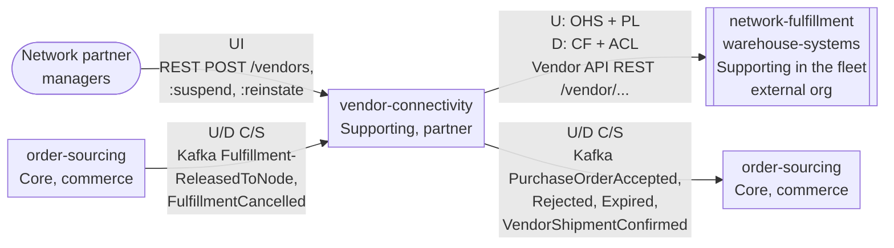
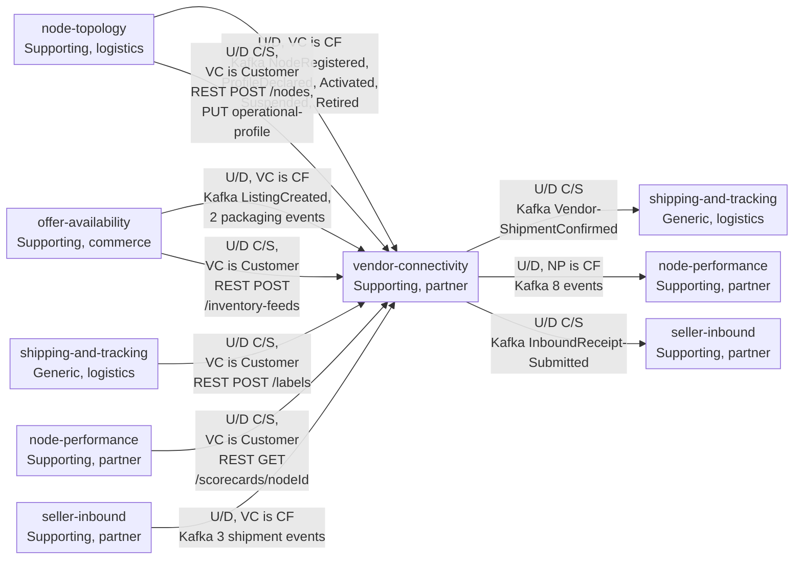

# Context Map

Following ddd-crew [Context Mapping](https://github.com/ddd-crew/context-mapping).
This is **vendor-connectivity's slice** of the
[network context map](https://iqvo.github.io/warehouse-docs/network/strategic-design/context-map). Arrows point from
upstream (U) to downstream (D). Abbreviations: OHS = Open Host Service,
PL = Published Language, CF = Conformist, ACL = Anti-Corruption Layer,
C/S = Customer/Supplier.

### The vendor protocol and sourcing

Source: `internal/adapters/inbound/kafka/consumers.go`, `inbound_consumers.go`, `internal/adapters/outbound/kafka/encoder.go`, `internal/adapters/outbound/httpclient/clients.go`; see [Integration](/docs/ecosystem/integration) for the verification of each edge.

### Relays, master data and measurement

Source: `internal/adapters/inbound/kafka/consumers.go`, `inbound_consumers.go`, `internal/adapters/outbound/kafka/encoder.go`, `internal/adapters/outbound/httpclient/clients.go`; see [Integration](/docs/ecosystem/integration) for the verification of each edge.

`order-sourcing`, `shipping-and-tracking` and `node-performance` appear
twice, once on each side, because each is upstream for one relationship
and downstream for another.

Omitted: the four contexts with no edge to this one (`delivery-promise`,
`customer-ordering`, `linehaul-transportation`, `last-mile-delivery`),
which are Separate Ways from this context's point of view; the analytics
topic of `PurchaseOrderCancelled`, which no repository consumes; Kafka and Postgres as
infrastructure. The path parameter `{nodeId}` is written `nodeId` inside
the diagram. "Rejected, Expired" and "Activated, Suspended, Retired"
abbreviate the full event names listed in the table. `seller-inbound` appears twice for the same reason.

## Relationships

| Neighbour | Direction | Pattern | Channel | Messages | Why this pattern |
| --- | --- | --- | --- | --- | --- |
| network-fulfillment (warehouse-systems, vendor `V-WS`; Supporting in the fleet, external) | VC upstream, NF downstream | **OHS + PL** here; **Conformist + ACL** downstream | Vendor API REST, `apis/vendor-connectivity/openapi.yaml` | Commands: RegisterVendorNode, DeclareNodeProfile, SubmitInventory, SubmitAcknowledgement, RequestLabel, SubmitShipmentConfirmation. Queries: PollPurchaseOrders, GetPurchaseOrder, GetTransaction, GetNode, GetScorecard | Many vendors, one contract. The network will not tailor its protocol per vendor, so it publishes one; each vendor conforms and protects its own model behind an ACL. This is the only channel between the two organizations (`meta.hard_boundary`): no topic is shared and the network never calls the fleet. |
| Network partner managers (human) | upstream actor | UI | REST `POST /vendors` | OnboardVendor | Onboarding is a human act inside the network, not part of the vendor protocol. |
| order-sourcing (Core) | OS upstream for releases | **Customer/Supplier** | Kafka `retailnetwork.order-sourcing.events` | FulfillmentReleasedToNode, FulfillmentCancelled | Order-sourcing decides; this context turns a release into a purchase order. Both sides are in one organization and negotiate the release payload. |
| order-sourcing (Core) | VC upstream for vendor answers | **Customer/Supplier** | Kafka `retailnetwork.vendor-connectivity.events` | PurchaseOrderAccepted, PurchaseOrderRejected, PurchaseOrderExpired, VendorShipmentConfirmed | Order-sourcing's lock and reassignment depend on these facts; the payload carries `assignmentId` and `releaseNo` for it. |
| node-topology (Supporting) | NT upstream | **Conformist** | Kafka `retailnetwork.node-topology.events` | NodeRegistered, NodeActivated, NodeSuspended, NodeRetired | The node registry is master data; this context keeps a `VendorNodeView` as published. |
| node-topology (Supporting) | NT upstream (supplier of the service) | **Customer/Supplier**, VC is the Customer | REST (in-org) `POST /nodes`, `PUT /nodes/{nodeId}/operational-profile` | RegisterNode, DeclareOperationalProfile | Vendor node and profile writes are relayed to their owner; node-topology lists this context as a Customer. |
| offer-availability (Supporting) | OA upstream | **Conformist** | Kafka `retailnetwork.offer-availability.events` | ListingCreated | Listings are owned there; this context keeps a `ListingView`. |
| offer-availability (Supporting) | OA upstream (supplier of the service) | **Customer/Supplier**, VC is the Customer | REST (in-org) `POST /inventory-feeds` | ApplyInventoryFeed | Inventory feeds are applied by their owner. |
| shipping-and-tracking (Generic) | ST upstream (supplier of the service) | **Customer/Supplier**, VC is the Customer | REST (in-org) `POST /labels` | IssueLabel | Only shipping-and-tracking may see the ship-to address ([ADR 0006](https://iqvo.github.io/warehouse-docs/network/adr/0006-pii-confinement)); this context passes back only `labelRef`, `trackingNumber`, `carrier`. |
| shipping-and-tracking (Generic) | VC upstream | **Customer/Supplier** | Kafka `retailnetwork.vendor-connectivity.events` | VendorShipmentConfirmed | Starts the package journey on the shipping side. |
| node-performance (Supporting) | VC upstream | **Conformist** (NP downstream) | Kafka `retailnetwork.vendor-connectivity.events` | VendorOnboarded, PurchaseOrderIssued, PurchaseOrderAccepted, PurchaseOrderRejected, PurchaseOrderExpired, VendorShipmentConfirmed, SubmissionProcessed | Node-performance measures from observed facts and takes them as published. |
| node-performance (Supporting) | NP upstream (supplier of the service) | **Customer/Supplier**, VC is the Customer | REST (in-org) `GET /scorecards/{nodeId}` | GetScorecard | A vendor reads its scorecard through the Vendor API; this context relays it. |

## Notes on the patterns

- **Open Host Service + Published Language toward vendors.** The schemas
  in `openapi.yaml` are versioned as a contract. Internal events
  (`PurchaseOrderIssued` and the rest) are a different language for
  in-organization consumers and never reach a vendor.
- **The fleet's side.** network-fulfillment is Conformist (it cannot change
  the protocol) and keeps an ACL (`ports.NetworkGateway`), so no network
  term crosses into the rest of the fleet. The term mapping is on the
  [Ubiquitous Language](/docs/ddd/ubiquitous-language)
  page and, fleet-wide, on [WMS/WES integration](https://iqvo.github.io/warehouse-docs/network/integration/wms-wes-integration).
- **Relay, not ownership.** For nodes, profiles, inventory and labels this
  context is a Customer of the owning context. It validates the vendor's
  right to act and turns a synchronous in-org answer into a transaction
  outcome; it does not keep a second copy of the truth.
- **No Shared Kernel.** No code or table is shared with any neighbour.

## Seller inbound

> **Built**: [ADR 0005](/docs/adr/0005-inbound-shipments-receipts-and-catalog-packaging) of this repository realises the aggregator's seller-inbound design. The edges below are in the diagram above.

| Neighbour | Direction | Pattern | Channel | Messages | Why |
| --- | --- | --- | --- | --- | --- |
| `seller-inbound` | U → D (VC downstream) | Customer/Supplier | Kafka `retailnetwork.seller-inbound.events` | `InboundShipmentLabelled`, `InboundShipmentShipped`, `InboundShipmentReceived` | The Vendor API needs the carton manifest and the shipment's closing status; `seller-inbound` publishes what it needs. |
| `seller-inbound` | U → D (VC upstream) | Customer/Supplier | Kafka `retailnetwork.vendor-connectivity.events` | `InboundReceiptSubmitted` | The vendor's carton-level answer is relayed; `seller-inbound` applies it. |
| `offer-availability` | U → D | Conformist | Kafka `retailnetwork.offer-availability.events` | `CatalogItemPackagingDeclared`, `CatalogItemPackLevelRetired` | Packaging belongs to the catalogue. |
| `node-performance` | U → D (NP downstream) | Conformist | Kafka `retailnetwork.vendor-connectivity.events` | `InboundReceiptSubmitted` (besides the seven listed above) | Inbound timeliness and accuracy observations. |
| `network-fulfillment` (fleet) | Vendor API | OHS + PL | REST | `GET /vendor/inbound-shipments`, `GET /vendor/inbound-shipments/{shipmentId}`, `POST /vendor/inbound-receipts` | The seam is unchanged: the fleet calls the Vendor API and nothing else. |
