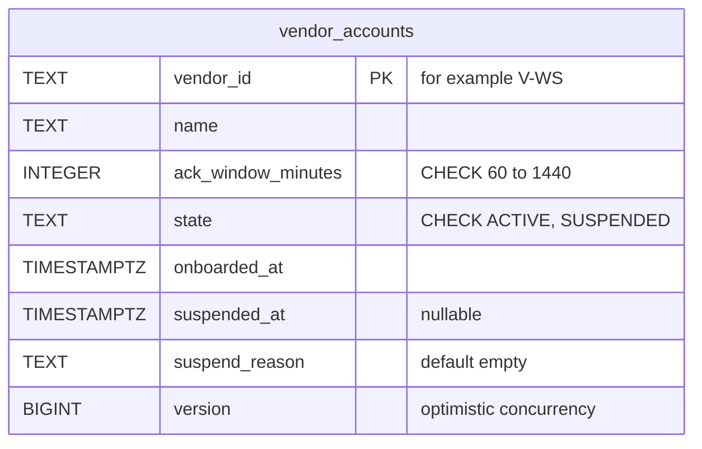
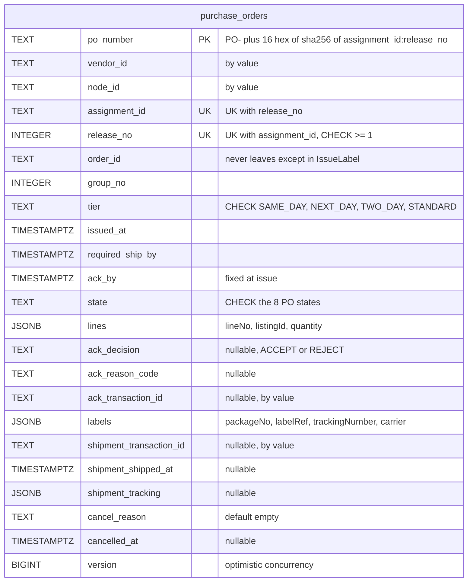
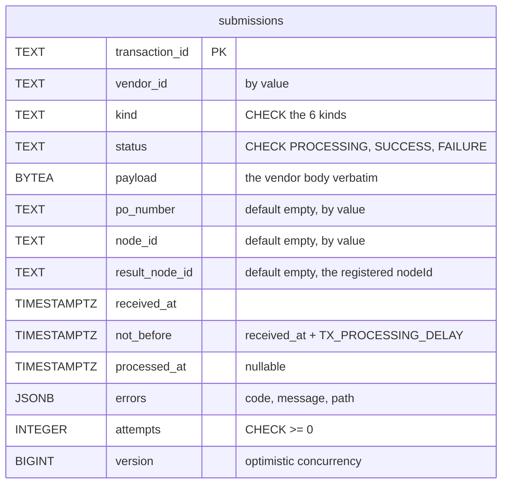
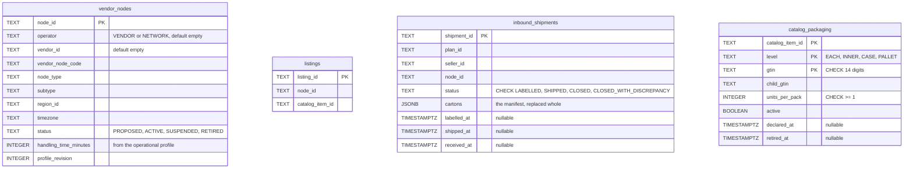
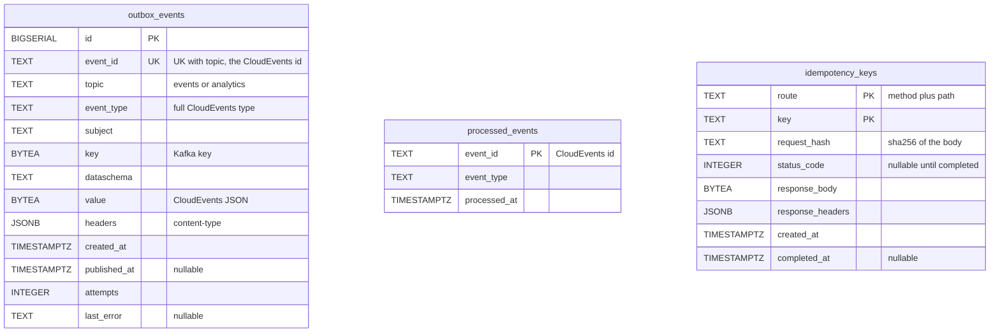

# Entity Relationship

The schema of this context's own database, as created by the two embedded migrations
(`internal/adapters/outbound/postgres/migrations/0001_vendor_connectivity_schema.up.sql` and
`0002_inbound_shipments_and_packaging.up.sql`). No other context reads it ("every context owns its
database; no shared tables"). There are **no foreign keys at all**: each aggregate is one row whose
value objects (order lines, labels, tracking numbers, submission errors, shipment cartons) are
JSONB columns, so an aggregate is loaded and saved by one primary key and one `version`. Links
between aggregates and to other contexts are by value.

## Aggregates

### VendorAccount

Source: `internal/adapters/outbound/postgres/migrations/0001_vendor_connectivity_schema.up.sql` (`vendor_accounts`).

### PurchaseOrder

Source: `internal/adapters/outbound/postgres/migrations/0001_vendor_connectivity_schema.up.sql` (`purchase_orders`) and `internal/adapters/outbound/postgres/repositories_purchase_order.go`.

### Submission

Source: `internal/adapters/outbound/postgres/migrations/0001_vendor_connectivity_schema.up.sql` (`submissions`), widened by `0002_inbound_shipments_and_packaging.up.sql` to allow the `INBOUND_RECEIPT` kind.

Indexes (all partial or keyset-friendly): `purchase_orders (vendor_id, issued_at, po_number)` for the
poll, `(node_id, issued_at, po_number)` per node, `(ack_by, po_number) WHERE state = 'ISSUED'` for
the expiry sweep; `submissions (not_before, transaction_id) WHERE status = 'PROCESSING'` for the
processor and `(processed_at) WHERE status <> 'PROCESSING'` for retention.

## Read models and infrastructure

### Read models

Source: `internal/adapters/outbound/postgres/migrations/0001_vendor_connectivity_schema.up.sql` (`vendor_nodes`, `listings`) and `0002_inbound_shipments_and_packaging.up.sql` (`inbound_shipments`, `catalog_packaging`); the repositories are in `inbound_repositories.go`.

`vendor_nodes` has a partial index on `(vendor_id, node_id) WHERE operator = 'VENDOR'`;
`inbound_shipments` has two partial indexes over `SHIPPED` rows for the poll.

### Infrastructure

Source: `internal/adapters/outbound/postgres/migrations/0001_vendor_connectivity_schema.up.sql` (`outbox_events`, `processed_events`, `idempotency_keys`), `outbox_repository.go` and `internal/adapters/inbound/http/idempotency.go`.

`outbox_events` has a partial index on `(id) WHERE published_at IS NULL` (the relay scans only the
unpublished tail); `idempotency_keys` is indexed on `created_at` for the retention sweep.
golang-migrate also keeps its own `schema_migrations (version, dirty)` table, which is not part of
the domain.

## Why there are no foreign keys

- `purchase_orders.vendor_id` and `.node_id`, `submissions.po_number`, `.node_id` and `.vendor_id`, and
  the transaction ids on `purchase_orders` are **by-value** links. Each aggregate is loaded and saved on
  its own, with its own version; a foreign key would couple their lifecycles and their locks.
- `node_id`, `listing_id`, `assignment_id` and the read-model tables point at facts **owned by other
  contexts**. The local copies arrive by events and can lag; a foreign key would turn an event-ordering
  race into a failed write.
- Labels hold `labelRef` and `trackingNumber` issued by shipping-and-tracking, by value. The ship-to
  address is not stored anywhere in this database.

## Table is not aggregate

| Table | Aggregate or role | Notes |
| --- | --- | --- |
| `vendor_accounts` | **VendorAccount** (root) | One row per vendor; never deleted. |
| `purchase_orders` | **PurchaseOrder** (root) | One row per release to a vendor node; `UNIQUE (assignment_id, release_no)` is the idempotency of `IssueOnRelease`. Lines, labels and shipment are value objects inside the row. |
| `submissions` | **Submission** (root) | Purged 30 days after processing by the retention sweeper. Errors are a JSONB value. |
| `vendor_nodes` | none (read model `VendorNodeView`) | Fed by node-topology events; also holds the handling time that feeds `ackBy`. |
| `listings` | none (read model `ListingView`) | Fed by offer-availability `ListingCreated`. |
| `inbound_shipments` | none (read model `InboundShipmentView`) | Fed by seller-inbound events; status only moves forward. |
| `catalog_packaging` | none (read model `CatalogPackagingView`) | Fed by offer-availability packaging events; a retired GTIN stays as history. |
| `outbox_events` | none (infrastructure) | Written in the same transaction as the aggregate change. |
| `processed_events` | none (infrastructure) | Written in the same transaction as the consumer's effect. |
| `idempotency_keys` | none (infrastructure) | Written in the same transaction as the use case it guards; purged after 24 h. |
