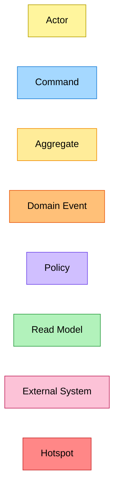
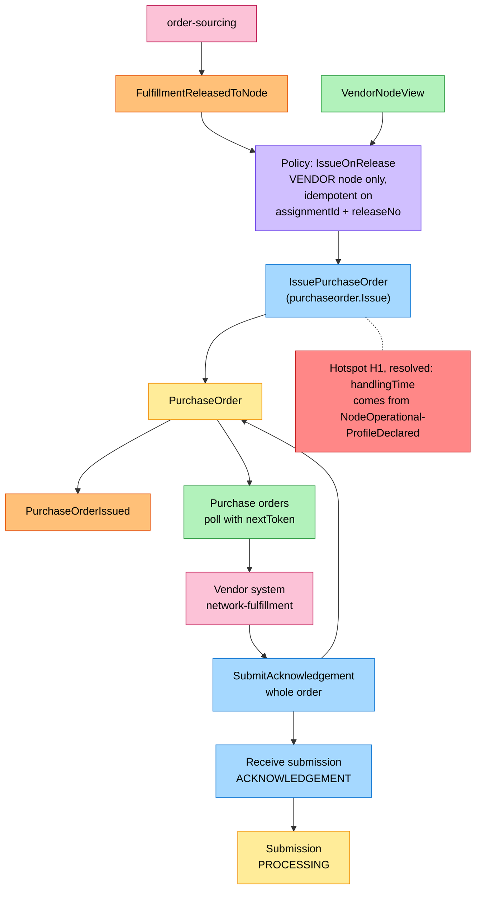
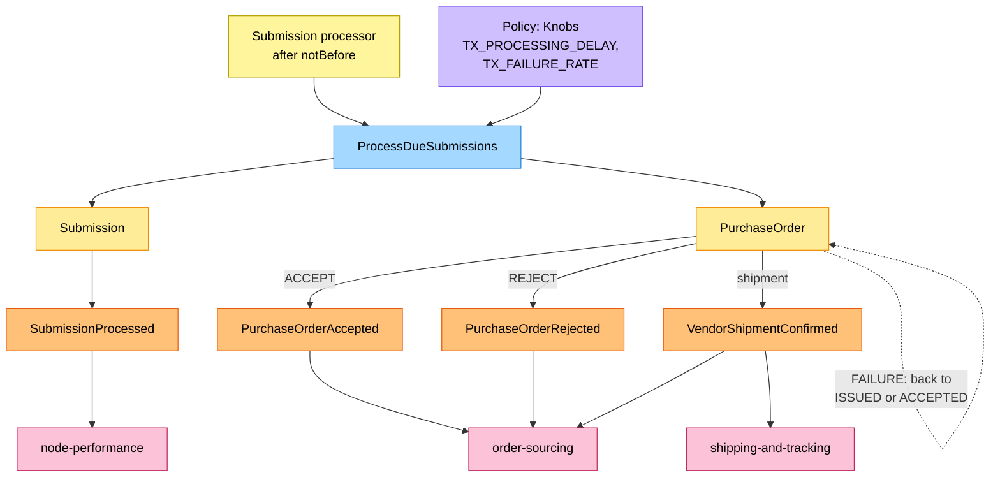
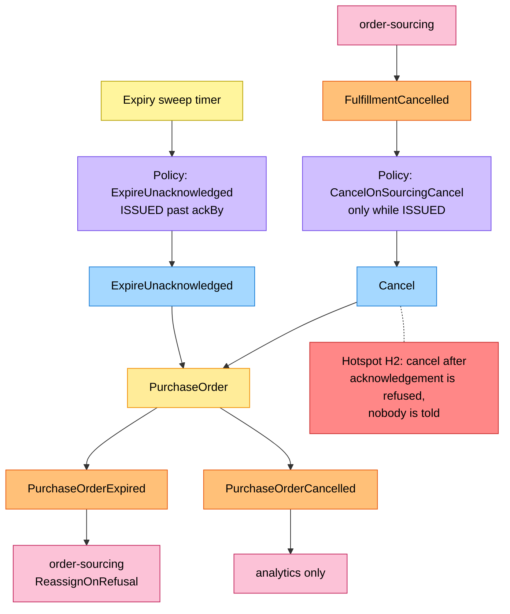
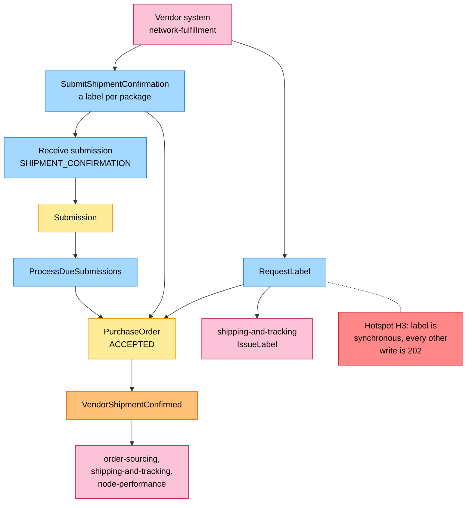
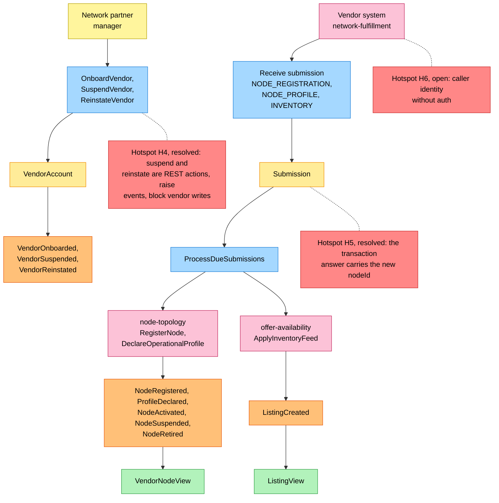

# EventStorming

Process-level boards in the ddd-crew
[EventStorming glossary & cheat sheet](https://github.com/ddd-crew/eventstorming-glossary-cheat-sheet)
notation. Every sticky is a command, aggregate, event, policy or read model
of the built service. Hotspots are the gaps the aggregator's model raised; the inventory at the end says which the code resolved and which stay open. The boards read top to
bottom (`flowchart TB`) so each stays inside the page width. The
network-wide board
is on [EventStorming big picture](https://iqvo.github.io/warehouse-docs/network/strategic-design/eventstorming-big-picture).

## Legend

| Sticky | Colour | Meaning |
| --- | --- | --- |
| Command | blue `#a5d8ff` | An intent: a vendor write, a policy's action, a sweep |
| Aggregate | yellow `#ffec99` | `VendorAccount`, `PurchaseOrder`, `Submission` |
| Domain Event | orange `#ffc078` | A published fact of this context, or a consumed fact of a neighbour |
| Policy | lilac `#d0bfff` | "Whenever X, then Y" |
| Read Model | green `#b2f2bb` | `VendorNodeView`, `ListingView`, or a query the vendor reads |
| External System | pink `#fcc2d7` | The vendor (the fleet) or a sibling context |
| Hotspot | red `#ff8787` | A gap or open question; marked *resolved* where the code settled it |
| Actor | pale yellow `#fff59d` | A person or a timer |

Source: `internal/application/usecases/service.go` and `internal/domain/*/events.go`.

## 1. Issue and acknowledge

Source: `internal/application/usecases/orders.go` (`IssueOnRelease`, `SubmitAcknowledgement`) and `internal/domain/purchaseorder/events.go`.

Omitted: the synchronous refusals at receipt (`ErrPartialAcknowledgement`,
`ErrAlreadyAcknowledged`, `ErrAckWindowClosed`, `ErrNodeNotOwnedByVendor`),
shown on [Use Cases](/docs/ddd/use-cases); the
`PO_REDELIVERY_RATE` re-delivery on poll.

## 2. Transaction outcomes

Source: `internal/application/usecases/submissions.go` (`ProcessDueSubmissions`, `finish`) and `internal/domain/*/events.go`.

Omitted: node-performance also consumes `PurchaseOrderAccepted`,
`PurchaseOrderRejected` and `VendorShipmentConfirmed`; the relay kinds
(`INVENTORY`, `NODE_REGISTRATION`, `NODE_PROFILE`) are on board 5, and inbound receipts (a sixth kind, ADR 0005) are not drawn here.

## 3. The clock and cancellation

Source: `internal/application/usecases/orders.go` (`ExpireUnacknowledged`, `CancelOnSourcingCancel`) and `cmd/api/background.go`.

Omitted: node-performance also consumes `PurchaseOrderExpired`.

## 4. Labels and shipment

Source: `internal/application/usecases/orders.go` (`RequestLabel`, `SubmitShipmentConfirmation`) and `internal/domain/purchaseorder/events.go`.

Omitted: `LabelIssued`, which shipping-and-tracking publishes and this
context does not consume.

## 5. Onboarding, nodes and inventory

Source: `internal/application/usecases/vendors.go`, `submissions.go` and `internal/domain/vendor/events.go`.

Omitted: the three account events have no consumer yet (`VendorOnboarded` was drawn to node-performance in the aggregator's model; the code only publishes it); `SubmissionProcessed`
goes out for every processed write (board 2).

## Sticky inventory

| Sticky | Kind | Source in the code |
| --- | --- | --- |
| Vendor system (network-fulfillment) | External System | The Vendor API in `internal/adapters/inbound/http`; the fleet is one vendor, `V-WS` |
| order-sourcing, node-topology, offer-availability, shipping-and-tracking, node-performance | External System | `internal/adapters/inbound/kafka/consumers.go` (consumed), `outbound/httpclient/clients.go` (called) and the events' consumers on [Integration](/docs/ecosystem/integration) |
| Network partner manager, expiry sweep timer, submission processor | Actor | `POST /vendors`; `startBackground` in `cmd/api/background.go` (the sweeper and the processor loops) |
| `OnboardVendor`, `SuspendVendor`, `ReinstateVendor`, `IssueOnRelease`, `SubmitAcknowledgement`, `RequestLabel`, `SubmitShipmentConfirmation`, `ExpireUnacknowledged`, `CancelOnSourcingCancel`, `ProcessDueSubmissions` | Command | Methods of `usecases.Service` |
| `VendorAccount`, `PurchaseOrder`, `Submission` | Aggregate | `internal/domain/vendor`, `purchaseorder`, `submission` |
| Published events | Domain Event | `internal/adapters/outbound/kafka/encoder.go`; see [Events](/docs/api-reference/events) |
| Consumed events | Domain Event | `internal/adapters/inbound/kafka/consumers.go`, `inbound_consumers.go` |
| `IssueOnRelease`, `CancelOnSourcingCancel`, `ExpireUnacknowledged`, `Knobs` | Policy | `usecases.Service` and `usecases.Knobs` |
| `VendorNodeView`, `ListingView`, purchase-order poll | Read Model | `network.Node`, `network.Listing`; `GET /vendor/purchase-orders` |
| H1: `ackBy` needs `handlingTime` | Hotspot, resolved | `NodeOperationalProfileDeclared` is consumed and stored as `handling_time_minutes` on `vendor_nodes`; `purchaseorder.ComputeAckBy` uses it |
| H2: cancel after acknowledgement is refused | Hotspot, open (one race) | `ErrCancelAfterAcknowledgement`; `CancelOnSourcingCancel` logs and publishes nothing; an acceptance after order-sourcing cancelled a `RELEASED` assignment is only logged there |
| H3: label is synchronous | Hotspot, kept by design | `POST /vendor/shipping-labels` answers `200` with the labels; it calls shipping-and-tracking inline |
| H4: suspension had no route, event or effect | Hotspot, resolved | `POST /vendors/{vendorId}:suspend` and `:reinstate`, `VendorSuspended` and `VendorReinstated`, `vendor.Account.EnsureActive` before every write |
| H5: vendor never learns its `nodeId` | Hotspot, resolved | `GET /vendor/transactions/{transactionId}` returns `nodeId` (`result_node_id`) |
| H6: caller identity without auth | Hotspot, open | `vendorId` is a body field and a required query parameter; `ErrNodeNotOwnedByVendor` is a consistency check, not authentication (in-cluster boundary) |
