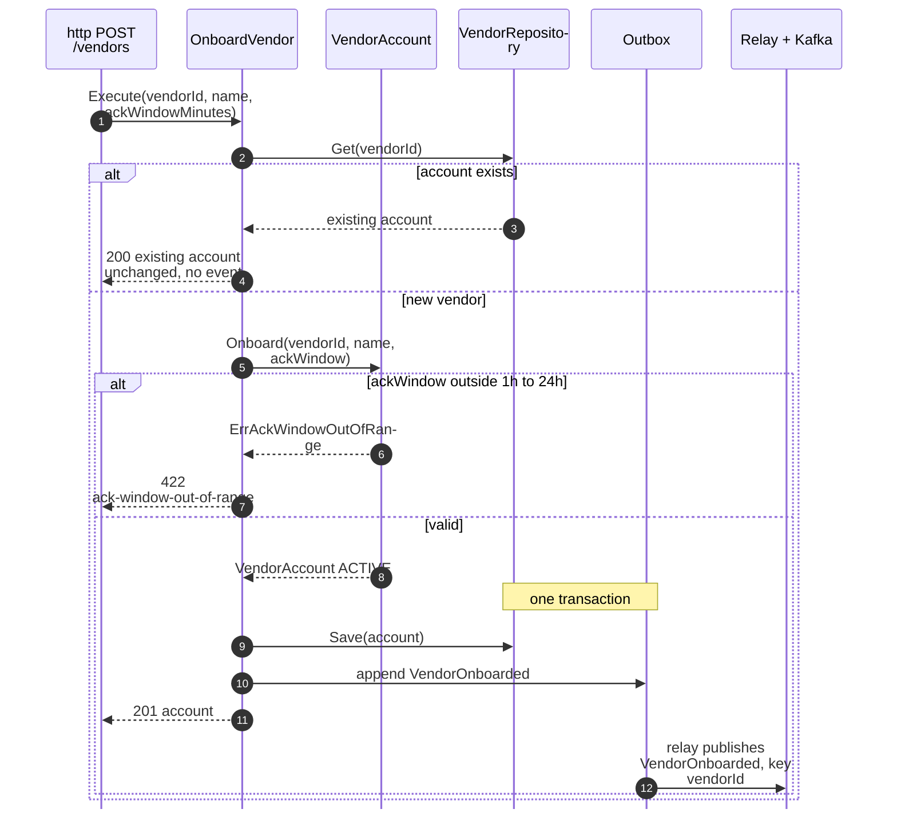
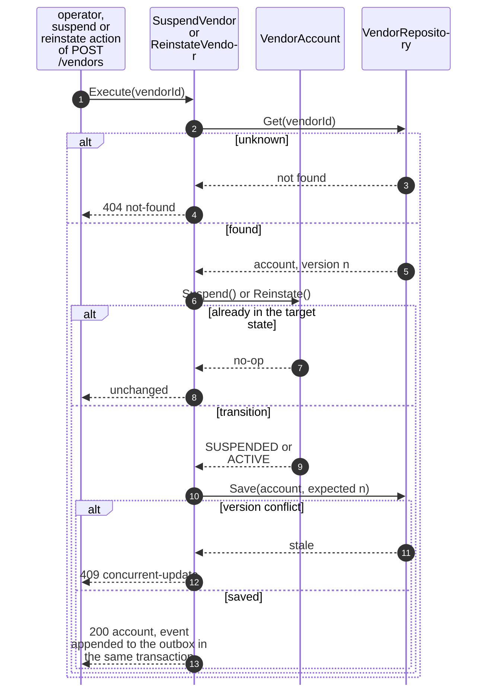
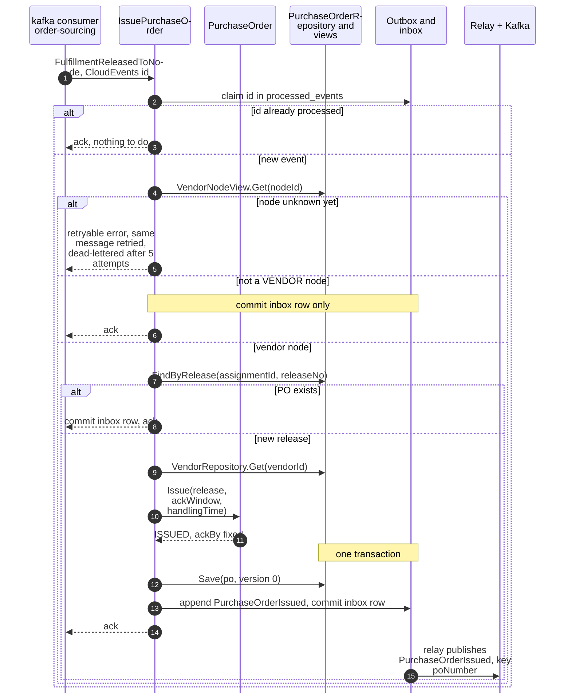
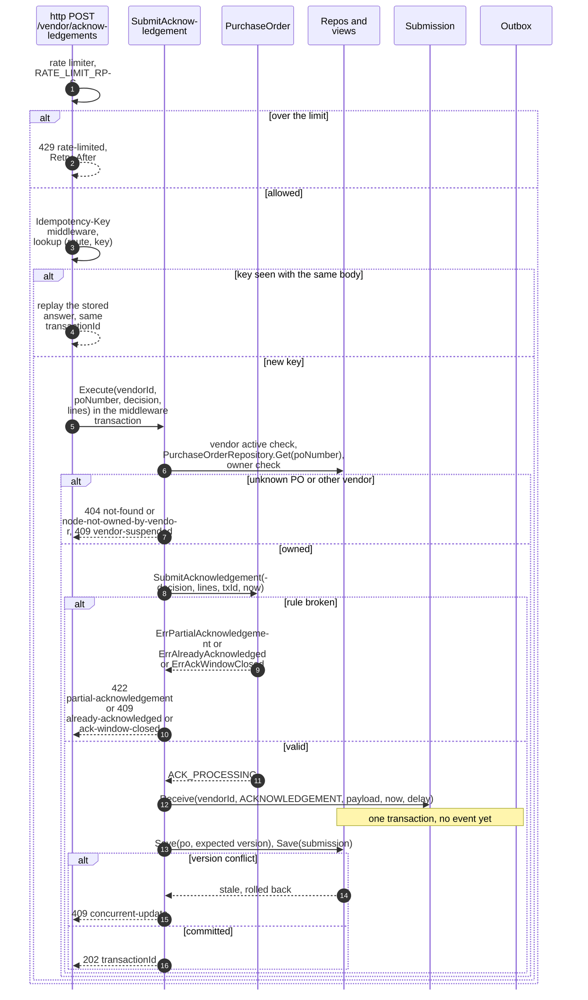
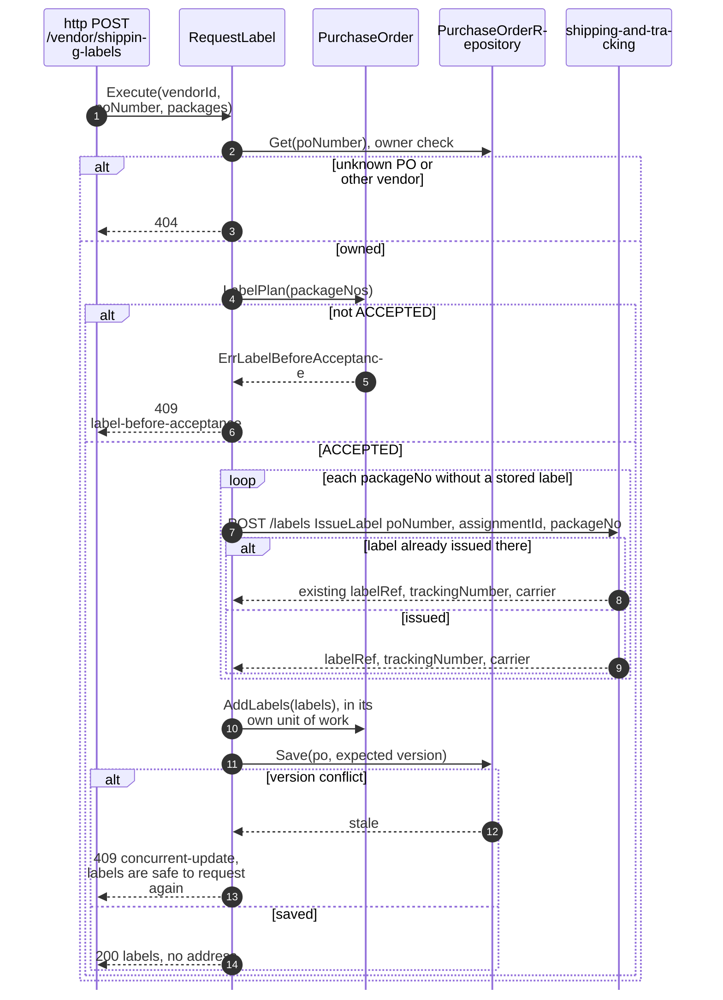
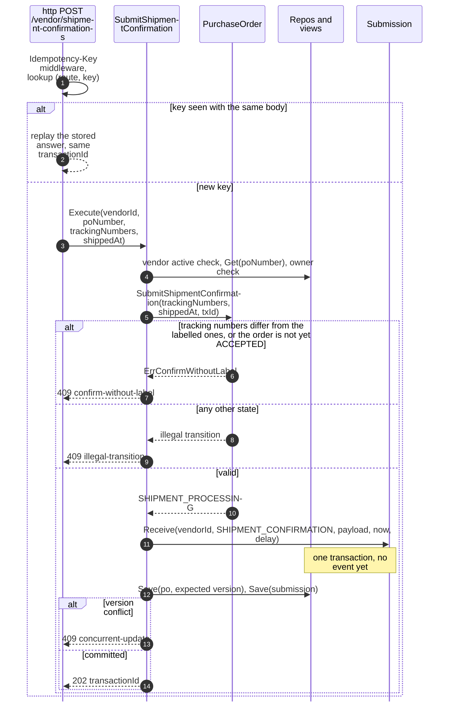
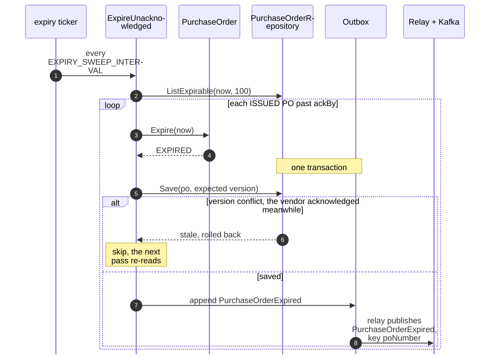
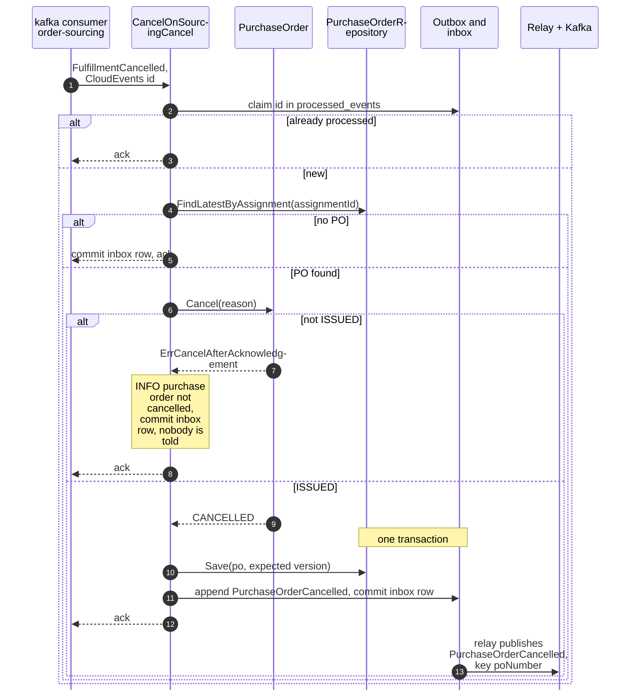
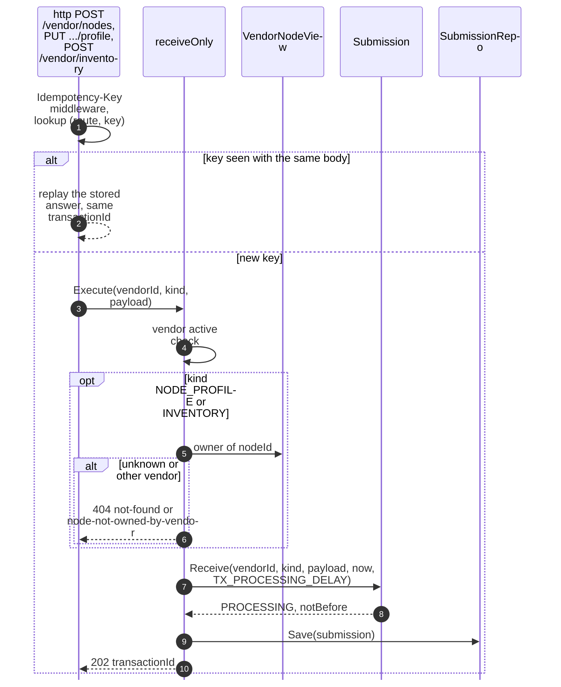

# Sequence Diagrams

One UML sequence per command use case on
[Use Cases](/docs/ddd/use-cases). Shared conventions:

- A repository saves with `WHERE version = :expected`; zero rows updated is a version conflict
  (`ErrConcurrentUpdate`, `409 concurrent-update`), and `Service.atomically` re-runs the unit once.
- `Outbox` rows are written **in the same database transaction** as the
  aggregate (`UoW`); a separate relay reads unpublished rows and produces
  them to Kafka `retailnetwork.vendor-connectivity.events`, then marks them
  published. The relay is drawn once per diagram as `Relay + Kafka`.
- Consumers claim the CloudEvents `id` in `processed_events` in the same
  transaction as their effect.
- Every `/vendor/...` request passes the rate limiter first (`429` with
  `Retry-After`); it is drawn only in diagram 4.
- Every write route sits behind the transactional `Idempotency-Key` middleware, which opens the
  Postgres transaction the use case then joins; a replay of the same key and body returns the stored
  answer without running the use case, and a 5xx rolls everything back.

Event names are short; the full types are on
[Domain Events](/docs/ddd/domain-events).

## 1. OnboardVendor

Source: `internal/application/usecases/vendors.go` (`OnboardVendor`) and `internal/adapters/inbound/http/server.go`.

Omitted: the `Idempotency-Key` replay (returns the stored answer); body
validation (`422 validation-failed`).

## 2. SuspendVendor and ReinstateVendor

Source: `internal/application/usecases/vendors.go` (`SuspendVendor`, `ReinstateVendor`) and `handleVendorAction` in `internal/adapters/inbound/http/handlers.go`.

Omitted: the outbox append and the relay, which work as in diagram 1 (`VendorSuspended` or `VendorReinstated`, key `vendorId`); a no-op raises no event. A suspended vendor's later writes answer `409 vendor-suspended`.

## 3. IssuePurchaseOrder (policy IssueOnRelease)

Source: `internal/application/usecases/orders.go` (`IssueOnRelease`, `issue`), `service.go` (`consume`) and `internal/adapters/inbound/kafka/consumers.go`.

Omitted: where `handlingTime` comes from (the node view, fed by `NodeOperationalProfileDeclared`); a vendor with no account or an invalid release is logged and dropped; `PO_REDELIVERY_RATE`, which acts on the poll, not here.

## 4. SubmitAcknowledgement

Source: `internal/application/usecases/orders.go` (`SubmitAcknowledgement`), `internal/adapters/inbound/http/ratelimit.go` and `idempotency.go`.

Omitted: the relay, because nothing is published at receipt;
`PurchaseOrderAccepted` or `PurchaseOrderRejected` follows in diagram 10.
The version-conflict branch is retried once inside the use case before it
is returned. A 4xx answer is stored by the middleware and replayed for the same key.

## 5. RequestLabel

Source: `internal/application/usecases/orders.go` (`RequestLabel`, `issueLabels`, `storeLabels`) and `internal/adapters/outbound/httpclient/clients.go`.

Omitted: outbox and relay, because this context publishes nothing here
(shipping-and-tracking publishes `LabelIssued`). shipping-and-tracking
unavailable answers `503 upstream-unavailable`, a refusal `502 upstream-refused`; labels
issued before the failure are stored and returned on the next request.

## 6. SubmitShipmentConfirmation

Source: `internal/application/usecases/orders.go` (`SubmitShipmentConfirmation`) and `internal/domain/purchaseorder/commands_shipment.go`.

Omitted: rate limiting and the `404` branch (as in diagram 4);
`VendorShipmentConfirmed` follows in diagram 10.

## 7. ExpireUnacknowledged (the expiry sweeper)

Source: `internal/application/usecases/orders.go` (`ExpireUnacknowledged`) and `cmd/api/background.go` (`startBackground`).

Omitted: a PO in `ACK_PROCESSING` is not listed; it is expired on a later
pass only if its transaction fails and returns it to `ISSUED` after
`ackBy`.

## 8. CancelOnSourcingCancel

Source: `internal/application/usecases/orders.go` (`CancelOnSourcingCancel`) and `internal/domain/purchaseorder/commands.go` (`Cancel`).

Omitted: a version conflict rolls back the whole transaction, including
the inbox row, so Kafka redelivers the event and the cancel is retried.

## 9. Receiving a node registration, profile or inventory write

Source: `internal/application/usecases/submissions.go` (`receiveOnly`, `RegisterVendorNode`, `DeclareNodeProfile`, `SubmitInventory`).

Omitted: rate limiting and body validation (`422 validation-failed`); outbox and
relay, because nothing is published at receipt. An inventory line whose listing belongs to another node is refused at receipt. Inbound receipts follow the same shape, with a shipment check and an `InboundReceiptSubmitted` event appended in the same unit.

## 10. ProcessSubmission

```mermaid
%%{init: {"sequence": {"wrap": true, "width": 120, "actorMargin": 24, "messageMargin": 28, "boxMargin": 6, "noteMargin": 6, "mirrorActors": false}}}%%
sequenceDiagram
    autonumber
    participant UC as ProcessDueSubmissions, on processor tick
    participant A as Submission and PurchaseOrder
    participant R as Repos
    participant NB as node-topology or offer-availability
    participant OB as Outbox
    participant K as Relay + Kafka
    UC->>R: ListDue(now, 100)
    loop each PROCESSING submission
        alt now before notBefore
            A-->>UC: ErrSubmissionNotDue, skip
        else due
            alt drawn by TX_FAILURE_RATE
                Note over UC: outcome FAILURE, simulated error
            else NODE_REGISTRATION, NODE_PROFILE or INVENTORY
                UC->>NB: POST /nodes, PUT operational-profile or POST /inventory-feeds
                alt 2xx
                    NB-->>UC: outcome SUCCESS
                else 4xx
                    NB-->>UC: outcome FAILURE, code is the owner's Err name
                else 5xx or timeout
                    Note over UC: stay PROCESSING, next tick, FAILURE ErrUpstreamUnavailable after 5 passes
                end
            else ACKNOWLEDGEMENT or SHIPMENT_CONFIRMATION
                Note over UC: outcome SUCCESS
            end
            UC->>A: Submission.Complete(outcome, now)
            alt outcome already set
                A-->>UC: ErrSubmissionAlreadyProcessed, skip
            else set
                opt PO kinds
                    UC->>A: PurchaseOrder outcome, ACCEPTED, REJECTED, ISSUED, SHIPPED or ACCEPTED
                end
                Note over R,OB: one transaction for both aggregates
                UC->>R: Save(submission, po, expected versions)
                alt version conflict
                    R-->>UC: rolled back, retried next tick
                else committed
                    UC->>OB: append SubmissionProcessed and the PO event if any
                    OB->>K: relay publishes, key transactionId or poNumber
                end
            end
        end
    end
```

Source: `internal/application/usecases/submissions.go` (`ProcessDueSubmissions`, `process`, `execute`, `finish`).

Omitted: the PO event is `PurchaseOrderAccepted`, `PurchaseOrderRejected`
or `VendorShipmentConfirmed` on success, and none on failure. Changing two
aggregates in one transaction is deliberate: `finish` saves the order, the
submission and the outbox rows in one unit of work (see [Use cases](/docs/ddd/use-cases)).
Acknowledgements, shipment confirmations and inbound receipts succeed at once; a processed
submission whose order has moved on is logged and the order left as is.
