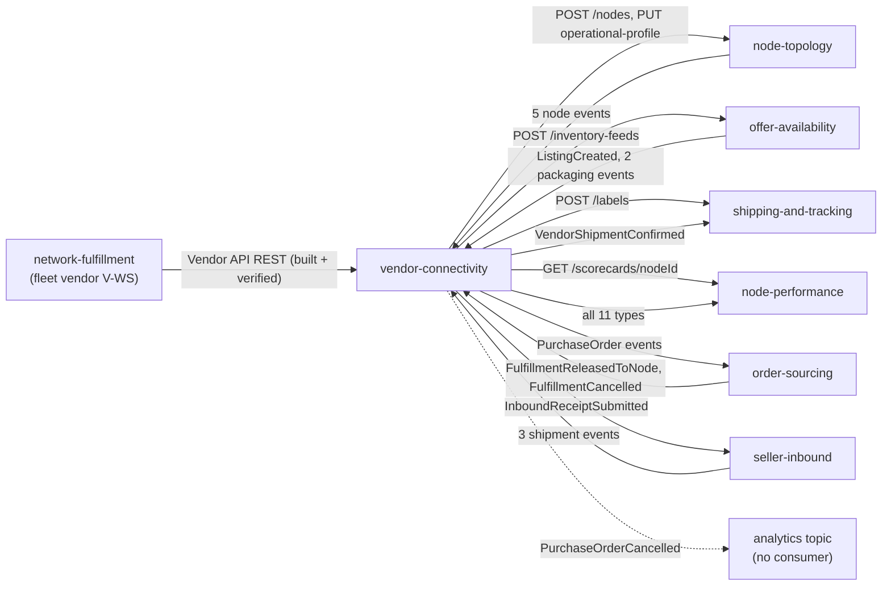

# Integration

How `vendor-connectivity` fits with the rest of the retail network and the fleet, with the
**status of every edge**. Three words are used strictly:

- **Built**: code in this repo that does the job.
- **Verified**: the other side was read on its own `origin/develop` ref in the local checkout
  (refs as they stood on 2026-11-01, not re-fetched for this page) and matches.
- **Absent**: no code on either side.

The context belongs to the retail network, not to the warehouse-systems fleet. Its design
rule is a hard boundary: **no `warehouse.*` topic is ever read or written, and this context
never calls a fleet service.** The fleet's `network-fulfillment` context is one *vendor*
(`V-WS`) that calls this context's Vendor API. All Kafka traffic is CloudEvents 1.0 on the
single platform broker, and every REST and agent surface is unauthenticated.

## Edge map

Source: `internal/adapters/inbound/kafka/consumers.go` and `inbound_consumers.go` (consumed topics
and types), `internal/adapters/outbound/kafka/encoder.go` (published topics),
`internal/adapters/outbound/httpclient/clients.go` (REST calls), `apis/asyncapi.yaml`, and the
neighbours' consumer code on their `origin/develop` (order-sourcing, node-performance,
shipping-and-tracking and seller-inbound `internal/adapters/inbound/kafka/`,
network-fulfillment `internal/adapters/outbound/retailnetwork/`). The solid edge to the analytics
topic does not exist: it is dotted because no repository reads it.

## Upstream: events this context consumes

Five consumers in `cmd/api`, each with its own stable consumer group, an inbox
(`processed_events`), a dead-letter topic `<topic>.dlq` and tolerant decoding (unknown fields
ignored; any other type on the topic is ignored).

| Producer | Topic | Full `type` | Effect here | Consumer group variable |
| --- | --- | --- | --- | --- |
| node-topology | `retailnetwork.node-topology.events` | `com.retailnetwork.logistics.node-topology.node.NodeRegistered` | Upsert the node in `vendor_nodes` | `NODE_CONSUMER_GROUP` |
| node-topology | same | `...node.NodeOperationalProfileDeclared` | Store handling time and profile revision (feeds `ackBy`) | same |
| node-topology | same | `...node.NodeActivated`, `NodeSuspended`, `NodeRetired` | Set the node status | same |
| offer-availability | `retailnetwork.offer-availability.events` | `com.retailnetwork.commerce.offer-availability.listing.ListingCreated` | Upsert the listing in `listings` | `LISTING_CONSUMER_GROUP` |
| order-sourcing | `retailnetwork.order-sourcing.events` | `com.retailnetwork.commerce.order-sourcing.assignment.FulfillmentReleasedToNode` | Issue a purchase order | `SOURCING_CONSUMER_GROUP` |
| order-sourcing | same | `...assignment.FulfillmentCancelled` | Cancel the order while `ISSUED` | same |
| seller-inbound | `retailnetwork.seller-inbound.events` | `com.retailnetwork.partner.seller-inbound.inboundshipment.InboundShipmentLabelled`, `InboundShipmentShipped`, `InboundShipmentReceived` | Maintain `inbound_shipments` | `INBOUND_CONSUMER_GROUP` |
| offer-availability | `retailnetwork.offer-availability.events` (second group) | `com.retailnetwork.partner.offer-availability.catalogitem.CatalogItemPackagingDeclared`, `CatalogItemPackLevelRetired`; the `commerce` tier spelling of the same two types is accepted too | Maintain `catalog_packaging` | `PACKAGING_CONSUMER_GROUP` |

Failure behaviour (`internal/adapters/inbound/kafka/kafka.go`, `consumer.go`, `deadletter.go`):

- A message that is not a valid CloudEvents 1.0 event is logged at WARN and committed past.
- A payload that cannot decode is dead-lettered at once, without retries.
- A transient failure (database down, unit of work rolled back) is retried on the same message
  with 200 ms doubling to 5 s, 5 attempts, then dead-lettered. The offset is committed only
  after success. A release for a node the view does not know yet fails with a retryable error
  (`ErrNodeNotKnown`), so it is retried and finally dead-lettered rather than silently lost.
- A broker connection that stalls is retried for up to 10 consecutive fetches; beyond that the
  consumer fails and the process exits so the orchestrator restarts it.
- Replays are safe: effects are idempotent on the CloudEvents `id`.

**Status.** Built. Verified for order-sourcing, node-topology, offer-availability and
seller-inbound as producers of these topics. The packaging types are the least pinned: the
producer's tier segment is not fixed yet, which is why both spellings are accepted
([ADR 0005](/docs/adr/0005-inbound-shipments-receipts-and-catalog-packaging)).

## Downstream: events this context publishes

Written through the transactional outbox and the always-on relay to
`retailnetwork.vendor-connectivity.events` (key = the subject), at least once with a stable
`id`. `PurchaseOrderCancelled` goes **only** to `retailnetwork.vendor-connectivity.analytics`.
The full catalogue is on [Events](/docs/api-reference/events).

| Consumer | Types read | Status |
| --- | --- | --- |
| order-sourcing | the `purchaseorder.` types (`PurchaseOrderAccepted`, `PurchaseOrderRejected`, `PurchaseOrderExpired`, `VendorShipmentConfirmed`) via its `VENDOR_CONNECTIVITY_CONSUMER_GROUP` consumer | Built + verified |
| node-performance | every type under the context's type prefix: `VendorOnboarded`, `PurchaseOrderIssued`, `Accepted`, `Rejected`, `Expired`, `VendorShipmentConfirmed`, `SubmissionProcessed` and `InboundReceiptSubmitted` | Built + verified |
| shipping-and-tracking | `VendorShipmentConfirmed` | Built + verified |
| seller-inbound | `InboundReceiptSubmitted` (subject: the shipment id) | Built + verified |
| any consumer of `retailnetwork.vendor-connectivity.analytics` | `PurchaseOrderCancelled` | **Absent**: no repository on local `origin/develop` reads that topic (only the ecosystem catalogue lists it). |

## Synchronous calls this context makes

Four plain REST calls over HTTP with a 5 s timeout (`internal/adapters/outbound/httpclient`).
Base URLs are mandatory variables with no default; a vendor's `transactionId` or a
deterministic key is sent as the `Idempotency-Key`.

| Neighbour | Call | Used by | Failure behaviour |
| --- | --- | --- | --- |
| node-topology (`NODE_TOPOLOGY_URL`) | `POST /nodes` (operator `VENDOR`), `PUT /nodes/{nodeId}/operational-profile` | node registration and profile submissions (asynchronous) | Timeout, outage or 5xx: the submission stays `PROCESSING`, retried for up to 5 passes, then `FAILURE` with `ErrUpstreamUnavailable`. A 4xx is a refusal: the transaction fails at once with the neighbour's `Err...` code. |
| offer-availability (`OFFER_AVAILABILITY_URL`) | `POST /inventory-feeds` (the `feedId` is the idempotency key) | inventory submissions (asynchronous) | As above; a repeat answered `ErrFeedAlreadyApplied` counts as success. |
| shipping-and-tracking (`SHIPPING_AND_TRACKING_URL`) | `POST /labels` with key `vc-label-<poNumber>-<packageNo>` | label request (synchronous) | `503 upstream-unavailable` on outage, `502 upstream-refused` on a 4xx; labels issued before the failure are kept. |
| node-performance (`NODE_PERFORMANCE_URL`) | `GET /scorecards/{nodeId}` | scorecard read (REST, MCP tool, A2A skill) | `503 upstream-unavailable` on outage. |

There is no circuit breaker; each call is independent and the unaffected parts of the API keep
working (see [Troubleshooting](/docs/operations/troubleshooting)). `cmd/mcp` and `cmd/a2a`
need the same four URLs because they share the application service, although only the
scorecard read calls out.

## Vendors: the Vendor API

Every vendor, including the fleet's `network-fulfillment` (vendor `V-WS`), integrates through
the REST contract in `apis/openapi.yaml`; see the [API overview](/docs/api-reference). The
fleet's side was verified in `network-fulfillment` on its `origin/develop`: its adapter
`internal/adapters/outbound/retailnetwork` carries a contract test against a copy of this
repository's OpenAPI document. The vendor protocol is polling plus transaction reconciliation:
there is no webhook or event feed to a vendor, and no event of this context ever reaches a
vendor.

## Agents and the console

| Surface | Status |
| --- | --- |
| Read-only MCP server (`cmd/mcp`, nine tools) | Built; routed by Kong at `/api/mcp/vendor-connectivity` when the chart's `mcp.route.enabled` is set. See [MCP tools](/docs/mcp/tools). |
| Read-only A2A agent (`cmd/a2a`, two skills) | Built; routed at `/api/a2a/vendor-connectivity` when `a2a.route.enabled` is set. |
| Console remote (`web/`, `vendor_connectivity_mfe`) | Built; calls only this context's own REST reads. Whether the console shell lists the remote is the console repository's concern and was not checked here. |

## Absent edges

- No call from this context to any fleet service, and no `warehouse.*` topic.
- No consumer of `retailnetwork.vendor-connectivity.analytics`.
- No webhook, callback or event delivery to vendors.
- No authentication or API key on any surface; access control is the in-cluster boundary.
- No call to `order-sourcing` over REST: assignment and reassignment stay with it, and this
  context only publishes the vendor's answer.
