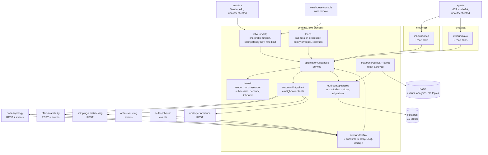

# Architecture

`vendor-connectivity` follows the fleet's hexagonal (ports and adapters) layout:
dependencies point inward, the domain imports nothing from the rest of the module, and only
`cmd/` wires the layers together. Three binaries share **one** application service
(`usecases.Service`); they differ in which inbound adapters and background workers they start.

## Layout

| Layer | Path | Role |
| --- | --- | --- |
| Domain | `internal/domain/vendor` | `Account` aggregate (VendorAccount): `Onboard`, `Suspend`, `Reinstate`, `EnsureActive`; events `VendorOnboarded`, `VendorSuspended`, `VendorReinstated`. |
| Domain | `internal/domain/purchaseorder` | `PurchaseOrder` aggregate: `Issue`, `SubmitAcknowledgement`, `ApplyAckOutcome`, `AddLabels`, `SubmitShipmentConfirmation`, `ApplyShipmentOutcome`, `Expire`, `Cancel`; `ComputeAckBy`; `NumberFor`. |
| Domain | `internal/domain/submission` | `Submission` aggregate: `Receive`, `RecordAttempt`, `Complete`; the six `Kind`s; event `SubmissionProcessed`. |
| Domain | `internal/domain/network` | `Node` and `Listing` value types of the local read models; `EnsureOwnedBy`, `VendorMayRegister`. |
| Domain | `internal/domain/inbound` | `Shipment`, `Carton`, `Receipt`, `PackLevel` and their rules; event `InboundReceiptSubmitted`. |
| Domain | `internal/domain/shared`, `shared/gs1` | `Event`, `Header`, validation helpers; GS1 GTIN and SSCC parsing and check digits. |
| Application | `internal/application/usecases` | The use cases (see [Use cases](/docs/ddd/use-cases)). |
| Application | `internal/application/ports`, `repository`, `outbox`, `gateway`, `requests`, `views` | The OUT ports (`UnitOfWork`, the repositories and view repositories, `EventOutbox`, `ProcessedEvents`, `Clock`, `IDGenerator`, `Random`, `NodeTopology`, `OfferAvailability`, `ShippingTracking`, `NodePerformance`, `SubmissionMetrics`), repository filters, the outbox `Message`, the neighbours' answer vocabulary and refusals, and the request and view DTOs. `ports` holds only interfaces. |
| Inbound adapter | `internal/adapters/inbound/http` | chi router for `apis/openapi.yaml`: handlers, RFC 9457 problem mapping (`errors.go`), the transactional `Idempotency-Key` middleware, the `RATE_LIMIT_RPS` token bucket, NUL rejection, `/healthz` and `/readyz`. No auth middleware. |
| Inbound adapter | `internal/adapters/inbound/kafka` | Five consumers (node, listing, sourcing, inbound, packaging): CloudEvents decode, dispatch on the full `type`, retry with backoff, dead-letter topic, trace spans. Decode only; every effect is a use case. |
| Inbound adapter | `internal/adapters/inbound/mcp` | The read-only MCP server (nine tools) behind a `Reads` interface. |
| Inbound adapter | `internal/adapters/inbound/a2a` | The read-only A2A agent (two skills, Agent Card). |
| Inbound adapter | `internal/adapters/inbound/requestlog` | One structured log line per request. |
| Outbound adapter | `internal/adapters/outbound/postgres` | pgxpool repositories, unit of work (`pgtx`), outbox repository, event outbox, embedded migrations (`migrate.go`, `migrations/`). |
| Outbound adapter | `internal/adapters/outbound/httpclient` | The four neighbour REST clients (5 s timeout). |
| Outbound adapter | `internal/adapters/outbound/kafka` | `Encoder` (domain events to CloudEvents outbox messages), `RelaySink`, `BrokerCheck` (the Kafka half of `/readyz`), writer settings. |
| Outbound adapter | `internal/adapters/outbound/outbox` | The relay loop that drains `outbox_events` to the sink. |
| Outbound adapter | `internal/adapters/outbound/telemetry` | OTel providers, the `vendor.submissions.processed` counter, trace-aware `slog` handler. |
| Outbound adapter | `internal/adapters/outbound/clock`, `ids` | Production clock, id generators, random source. |
| Outbound adapter | `internal/adapters/outbound/memory`, `repocontract` | In-memory implementation of every port and the shared repository contract suite: **test doubles**. No `cmd/**` file imports them (`TestRuntimeBinaryHasNoInMemoryAdapters`). |
| Kafka envelope | `internal/adapters/kafka/cloudevents` | The only place a CloudEvents 1.0 envelope is built or decoded: `New(Spec)`, `Decode`, `Type`, `DataSchema`, `ContentTypeHeader`. `Tier = "partner"`, `Context = "vendor-connectivity"`, `Source = "/retailnetwork/vendor-connectivity"`. |
| Support | `internal/bootretry` | Exponential-backoff retry for the first outbound dials at boot. |
| Composition roots | `cmd/api`, `cmd/mcp`, `cmd/a2a` | `cmd/api`: `main.go` (run, shutdown order), `config.go` (env parsing), `wire_adapters.go` (Postgres adapters, readiness), `background.go` (consumers, loops, relay, `watchWorkers`), `telemetry.go`. |
| Test support | `internal/testing/{kafkatest,pgtest}` | Testcontainers helpers. |
| Fitness tests | `internal/architecture` | arch-go and source-scanning tests; see [Testing](/docs/development/testing). |

## Binaries and ports

| Binary | Role | Port | Probes |
| --- | --- | --- | --- |
| `cmd/api` | Vendor REST API, outbox relay, five Kafka consumers and three loops (submission processor, expiry sweeper, retention sweeper) in one process, all always on, on real Postgres and Kafka. Exits non-zero when any worker dies. | `HTTP_ADDR`, default `:8080` | `GET /healthz` (liveness), `GET /readyz` (drain gate, Postgres ping, a Kafka broker answers a metadata request; never topics) |
| `cmd/mcp` | Read-only MCP server over Streamable HTTP at `/mcp` and `/`; same `Service`, only the read methods reachable; no relay, consumer, loop or Kafka client. Runs the embedded migrations at boot, so it can start on a fresh database. | `MCP_ADDR`, default `:8090` | `GET /healthz` |
| `cmd/a2a` | Read-only A2A (Agent2Agent) agent: JSON-RPC at `/` and `/a2a`, Agent Card at `/.well-known/agent-card.json`; same constraints as `cmd/mcp`. | `A2A_ADDR`, default `:8093` | `GET /healthz` |

`web/` is not a Go binary: the `vendor_connectivity_mfe` Module Federation remote
([ADR 0007](/docs/adr/0007-console-remote)), served by its own nginx image under
`/mfes/vendor-connectivity/` (dev and preview port 4021), with four read-only screens
(orders, order detail, nodes, inbound) over the existing REST reads. The Helm chart renders
`mcp`, `a2a` and `frontend` only when enabled (off by default); see the
[Runbook](/docs/operations/runbook). Boot order and shutdown order are in
[Runtime](/docs/overview/runtime); every variable is in
[Configuration](/docs/operations/configuration).

## Container diagram

Source: `cmd/api/main.go`, `cmd/api/background.go` and `cmd/api/wire_adapters.go` (wiring and
workers), `cmd/mcp/main.go`, `cmd/a2a/main.go`, `internal/application/usecases/service.go`
(`Deps`) and `internal/adapters/inbound/kafka/consumers.go`. `cmd/mcp` and `cmd/a2a` build the
same `Service` over the same Postgres repositories and the same four neighbour clients but
never start a consumer or the relay, so for them the Kafka edges do not exist.

## Data stores

One Postgres database owned by this context, created by two embedded migrations
(`internal/adapters/outbound/postgres/migrations/0001_vendor_connectivity_schema.up.sql` and
`0002_inbound_shipments_and_packaging.up.sql`):

| Table | Holds |
| --- | --- |
| `vendor_accounts` | The VendorAccount aggregate; `version` guards updates. |
| `purchase_orders` | The PurchaseOrder aggregate; lines, labels and tracking numbers are JSONB value objects; unique on (`assignment_id`, `release_no`). |
| `submissions` | The Submission aggregate: the vendor body verbatim (`BYTEA`), kind, status, `not_before`, attempts, errors. |
| `vendor_nodes`, `listings` | Local read models of node-topology's nodes and offer-availability's listings. |
| `inbound_shipments`, `catalog_packaging` | Local read models of seller-inbound's shipments (manifest as JSONB) and offer-availability's packaging hierarchy. |
| `outbox_events` | The transactional outbox: one already-encoded Kafka message per row, with `attempts` and `last_error`. |
| `processed_events` | The consumers' inbox: the CloudEvents `id` is claimed in the same transaction as the effect. |
| `idempotency_keys` | Stored answers of the write routes, keyed by (`route`, `key`), 24 h. |

Postgres is the only store: the service refuses to boot without `DATABASE_URL`. Kafka is the
fleet's single broker; this service produces to `retailnetwork.vendor-connectivity.events`
and `retailnetwork.vendor-connectivity.analytics`, consumes
`retailnetwork.node-topology.events`, `retailnetwork.offer-availability.events` (two consumer
groups), `retailnetwork.order-sourcing.events` and `retailnetwork.seller-inbound.events`, and
dead-letters to `<topic>.dlq`. It never creates a topic through an admin API: the broker
auto-creates each on first write (`AllowAutoTopicCreation`), and `/readyz` does not wait for
any topic.

## Rules enforced by `internal/architecture`

The tests run on every PR (`arch-test` job, `make arch-test`):

| Test | Rule |
| --- | --- |
| `TestHexagonalArchitecture` | Domain depends only on domain; application only on domain and application; inbound adapters do not depend on outbound adapters and the reverse; nothing under `internal/` imports `cmd`; `internal/application/ports` holds only interfaces. |
| `TestMCPAdapterDependencyRule`, `TestMCPOptionalToolInputsCarryOmitempty` | The MCP adapter depends only on application and domain, nothing depends on it, optional tool inputs stay optional. |
| `TestA2AAdapterDependencyRule`, `TestA2AAgentIsReadOnly`, `TestA2AAdapterHasNoOutboundA2AClient` | The A2A adapter depends only on application and domain, reaches only read use cases, and there is no outbound A2A client: this context is delegated to and never delegates. |
| `TestNoAuthMiddlewareReintroduced` | No bearer or JWT code in the inbound adapters: REST, MCP and A2A are unauthenticated fleet-wide. |
| `TestRuntimeBinaryHasNoInMemoryAdapters` | No non-test file under `cmd/**` imports the memory adapter or `repocontract`. |
| `TestCloudEventsOnly`, `TestNoEventEnvelopeToggleOrFlatEnvelope`, `TestEventCatalogueMatchesContract` | CloudEvents 1.0 is the only envelope and the published catalogue equals `apis/asyncapi.yaml`. |
| `TestKafkaConsumerGroupNeverHardcodedInline`, `TestKafkaWritersSetRequiredAcks`, `TestKafkaWriterTopicNotSetTwice`, `TestDeadLetterCallsGuardCancellation`, `TestOutboxRelaysPassAttemptCap` | Kafka hygiene. |
| `TestNoGoFilesAtRepoRoot` | Go files live under `cmd/` and `internal/`. |
| `TestPostgresIntegrationTestsUseTestcontainers`, `TestKafkaIntegrationTestsUseTestcontainers` | Integration tests boot their own containers. |
